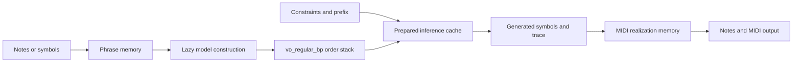

# Continuator architecture

Continuator has one generation engine: the external `vo_regular_bp` order-stack
library. `ctor.continuator.Continuator2` is the stable MIDI facade;
`ctor.sequence_model.SequenceModel` exposes the same backend for arbitrary
hashable symbols. Historical engines are recoverable as described in
[migration.md](migration.md).

## Responsibilities

- `ctor/sequence_model.py`: symbolic learning, generation semantics, seeded RNG,
  backend preparation, inference cache, traces and lazy diagnostics. It delegates
  all BP, regular-constraint compilation and order policy to `vo_regular_bp`.
- `ctor/vo_regular_bp/continuator.py`: Note/viewpoint conversion, phrase memory,
  transposition and MIDI-facing compatibility methods. It composes SequenceModel.
- `ctor/midi/realization_store.py`: original notes and viewpoint-to-address indexes.
  Exact duplicate phrases retain their learning weights and memory entries but
  share equivalent address domains during realization.
- `ctor/vo_regular_bp/realization_store.py`: transform-aware addresses for optional
  virtual transposition; concrete transposed notes are realized lazily.
- `ctor/midi/base.py`: MIDI parsing/writing, timing and dynamic-programming
  realization. Source address continuity and overlap compatibility determine cost.
- `ctor/constraints.py`: positional equality/one-of builder. The external
  `ConstraintSet` additionally supports forbidden motifs and regular acceptors.
- `ctor/ui/` and `ctor/phrase_listener.py`: optional local Gradio and MIDI I/O.

## Generation semantics

Unprompted fixed sampling starts from an empirical distribution over learned
symbols. A hidden synthetic root adds those priors to an OrderStackModel; the
external backend still performs all constrained inference. An explicit START
handoff requests a learned phrase beginning. Explicit emitted START is supported
at position zero; END is supported at the last position when explicitly allowed,
including a final note/END union. Other unconstrained positions exclude markers.

Until generation starts from the supplied prefix, or hidden START if omitted.
It uses the backend's shared first-hit tables and stops within a finite window.
The stop symbol is included in the returned length. Prefixes are never returned.
All positional constraints index only returned generated material.

## Learning and caches

Learning or deleting phrases invalidates the symbolic model, all prepared
inference and the last trace. Model construction is deferred until generation or
explicit `order_model` inspection. Thus learning a folder builds the complete
symbolic memory once at first use. Deletion rebuilds realization indexes from
retained phrases so canonical duplicate addresses remain valid.

Fixed-length caches hold prefix-independent backend plans. Different prefixes
bind to the same backward tables. Until caches hold backends keyed by prefix,
stop symbol/set, length window and policy. Callback predicates, regular product
constraints and constrained until requests bypass caching because their state
or memory requirements are not safely represented by these keys.

The cache uses LRU eviction, at most eight entries by default, and a 64 MiB
estimated backward-table admission budget. This estimate is not a process-RSS
limit: model graphs, native allocations and backend candidate caches also use
memory. `cache_size=0` disables caching. Constraint values and built-in policy
settings are included in keys; memory changes and transposition-setting changes
invalidate all entries. Diagnostics are computed only when requested, keeping
expensive per-length diagnostic enumeration off the generation path.

## Dependency and release

The dependency is pinned to immutable backend commit
`ae05b8799a9698d986afbe2b010194b32aa2c678`, which includes shared first-hit backward
messages. This replaces v0.1.1's separate inference pass for every candidate
length. The full upstream tests and the Continuator contract are checked against
that revision. Continuator 2.0 makes the removal of older engine APIs explicit.

Run `python -m pytest -q` for active coverage and
`python -m benchmarks.engine_audit --samples 100 --repeats 5 --long-until --output /tmp/audit.json`
for the reproducible workload and performance report.
